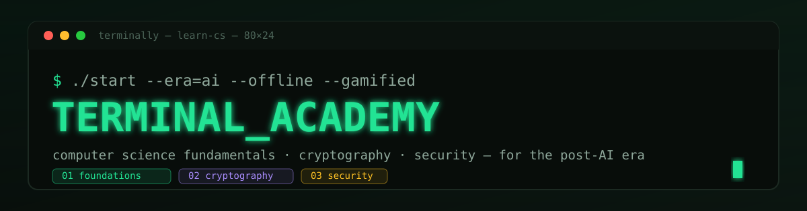
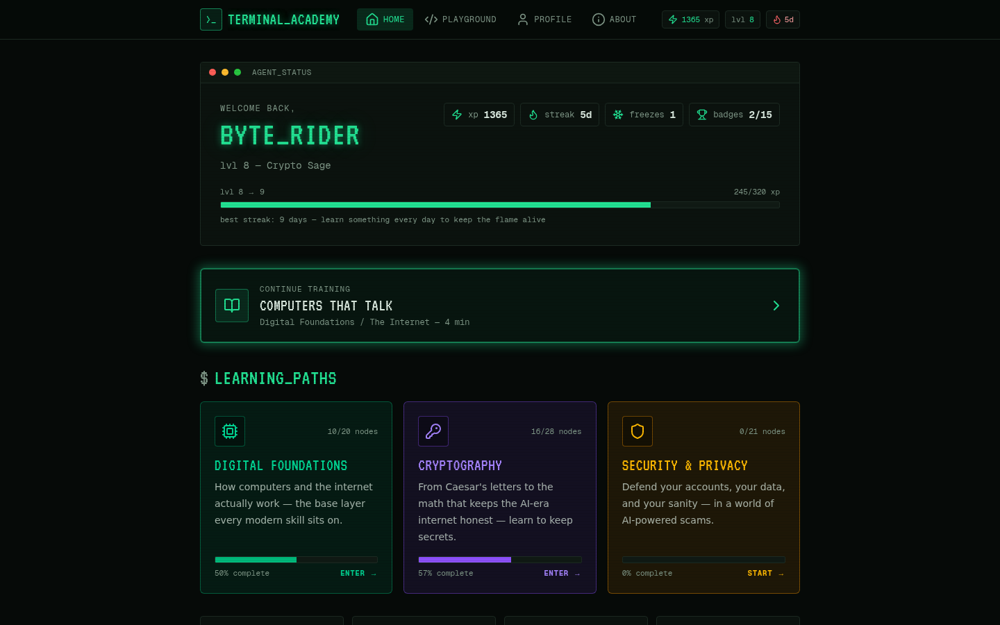
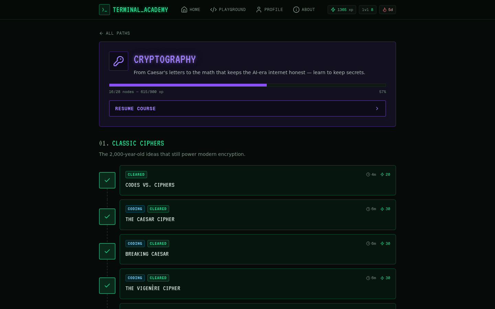
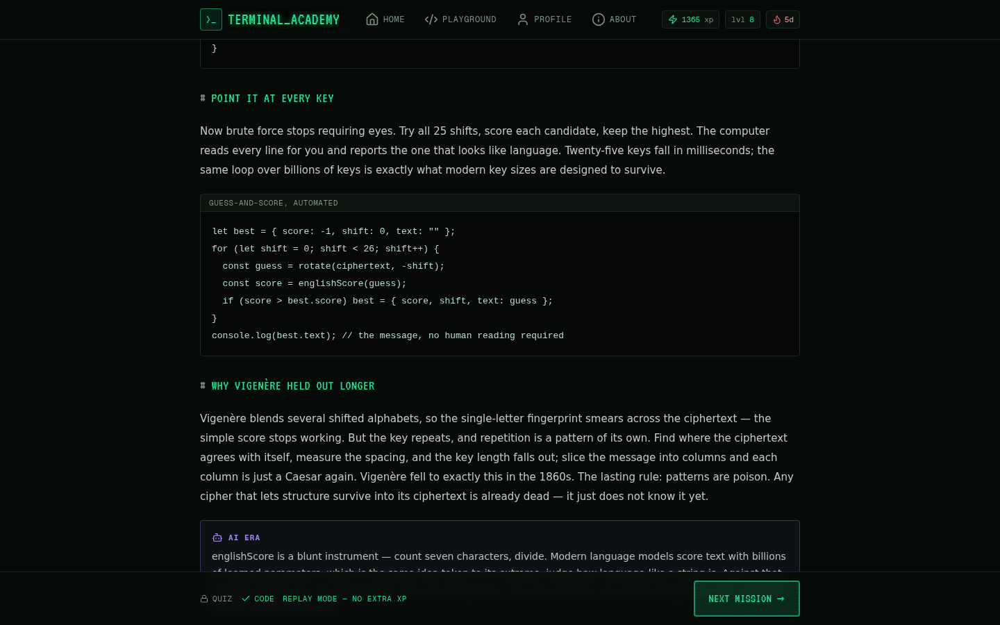
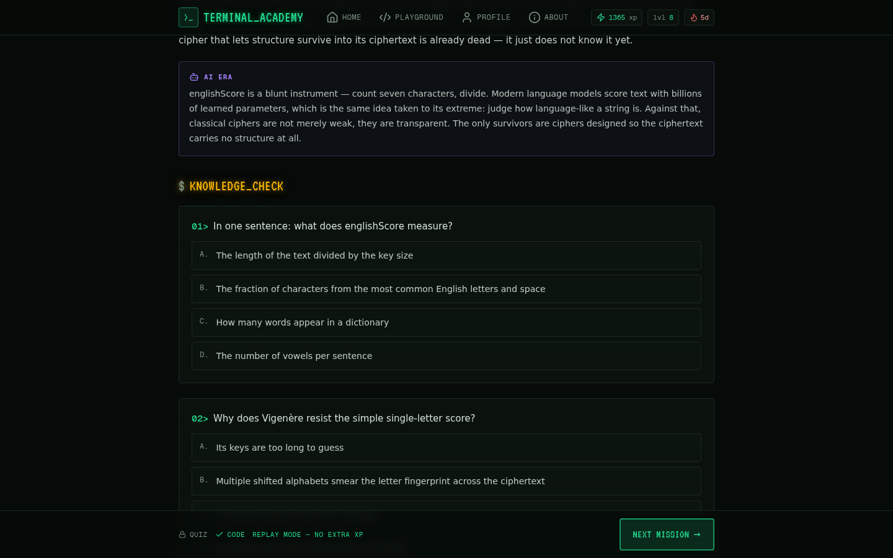
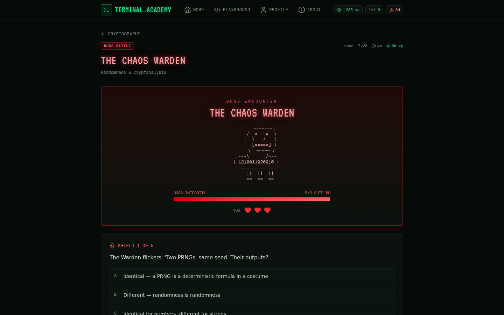
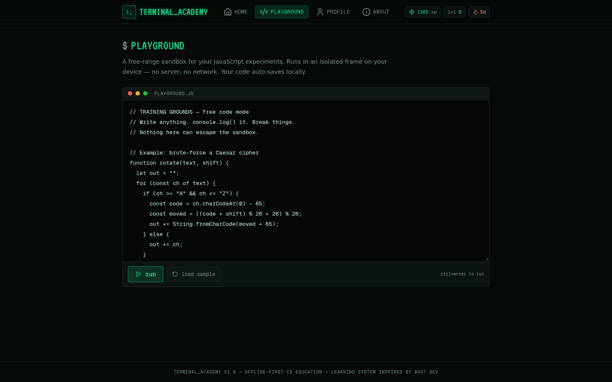
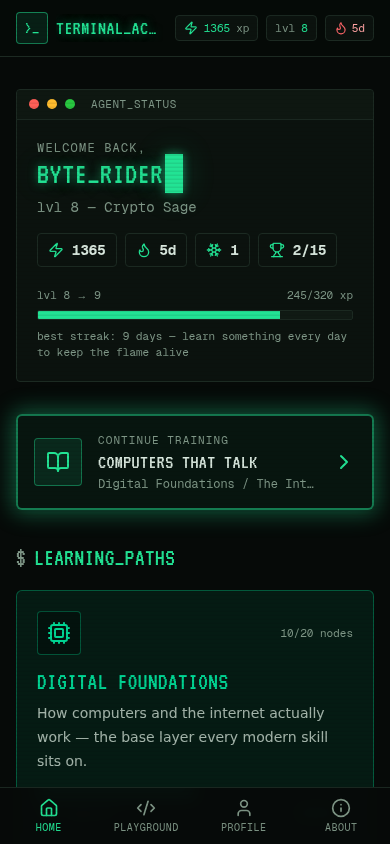
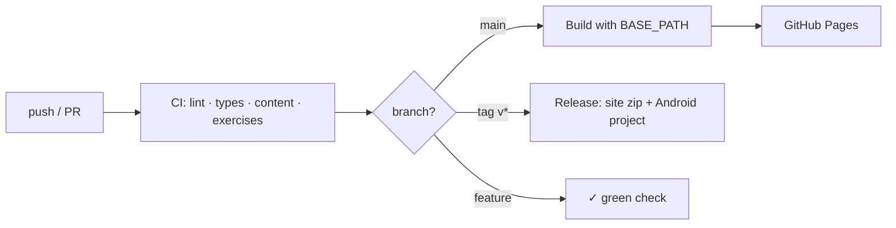

<p align="center">
  
</p>

# Terminally — Terminal Academy

**A gamified, offline-first learning system for the computer science that actually matters in the post-AI era.**
Read a micro-lesson → prove it in a quiz → *write the code yourself* in a sandboxed browser editor →
defend your knowledge in a boss battle. Everything runs client-side: no accounts, no backend, no internet required.


---

## The tour

| | |
|---|---|
| **Your command center** — XP, level, daily streak and your three learning paths. | **The course map** — linear chapters, unlockable nodes, boss gates. |
|  |  |
| **Micro-lessons & knowledge checks** — concepts, real code and instant quizzes; perfect runs pay bonus XP. | **In-browser coding** — a sandboxed JS editor with auto-graded tests and hints. |
|  |  |
| **Boss battles** — multi-stage combat where wrong answers cost your shield. | **Training grounds** — a free playground that works offline. |
|  |  |
| **Fully responsive** — bottom navigation and touch-first layout on mobile. | |
|  | |

Your profile tracks badges, streak freezes, XP history and a portable JSON save file
(import/export) — all in `localStorage`: [profile screenshot](docs/screenshots/profile.png),
[about page](docs/screenshots/about.png).

---

## The curriculum — 3 courses · 69 nodes

Learners don't just *watch* cryptography: they **build** Caesar, Vigenère, XOR, hashes and
salting with their own hands before the course escalates to AES, RSA, Diffie-Hellman, TLS,
end-to-end encryption, zero-knowledge proofs and post-quantum schemes.

| # | Course | Chapters | What you build & learn |
|---|--------|----------|------------------------|
| 01 | 🟢 **Digital Foundations** *(20 nodes)* | Bits & Bytes · Logic & Code · The Internet · **Data, Errors & Compression** | Binary → bytes → text encodings, boolean logic, branching, loops, packets/DNS/HTTP, plus hex, base64, checksums and run-length compression — each with a coding exercise |
| 02 | 🟣 **Cryptography** *(28 nodes)* | Classic Ciphers · Modern Building Blocks · **Randomness & Cryptanalysis** · Public-Key Revolution · Crypto in the AI Age | Caesar, Vigenère, XOR, one-time pads, hashing & salting (implemented by *you*), symmetric vs. public-key, RSA intuition, Diffie-Hellman, signatures, HTTPS, E2EE, ZK proofs, post-quantum — and why PRNGs, nonces and frequency analysis decide who wins |
| 03 | 🟡 **Security & Privacy** *(21 nodes)* | Your Digital Fortress · Attacks & Defenses · **Everyday Network Defense** · Privacy in the AI Era | Threat modeling, password entropy (computed in JS), managers & passkeys, 2FA, phishing & AI scams, malware, zero trust, evil-twin Wi-Fi, VPN reality-checks, router hardening, patch strategy, deepfake defense — capped by the **Phishing Gauntlet** boss |

**Content totals:** 56 lessons · 13 boss battles · 162 quiz questions · 77 boss stages ·
21 auto-graded exercises · **2,240 XP** of earnable content · 15 badges · 10 level ranks.

> Chapters in **bold** shipped in the latest content expansion. Every exercise ships with a
> verified reference solution and tests that the starter code deliberately fails — no freebies.

---

## Why it's built this way

- **boot.dev-style loop** — concept → quiz → hands-on code, in 3–6 minute nodes. Linear paths
  with boss gates beat endless video catalogs for beginners.
- **Post-AI curriculum** — the skills that stay valuable when AI writes your boilerplate:
  how machines represent data, how secrets actually work, and how attackers think.
- **Offline-first** — a service worker caches the whole app; progress lives in `localStorage`.
  Load it once, then learn on a plane. The same build ships inside an Android WebView shell.
- **Zero backend** — everything (including the sandboxed code runner) is static, which makes
  the CI/CD story trivial: *if it builds, it ships.*

---

## Quickstart

```bash
git clone https://github.com/touhidsiddiqueeraj-bit/Terminally.git
cd Terminally
bun install          # or: npm install
bun run dev          # http://localhost:3000
```

All the commands:

| Command | What it does |
|---|---|
| `bun run dev` | Dev server on port 3000 |
| `bun run lint` | ESLint over the whole repo |
| `bun run typecheck` | `tsc --noEmit` (strict) |
| `bun run validate:content` | Course data sanity: unique IDs, quiz answers in range, boss stages, XP values |
| `bun run verify:exercises` | Runs every exercise: solutions must pass all tests, starters must fail them |
| `bun run build:static` | Static export → `out/` (what CI deploys and what the Android app wraps) |
| `BASE_PATH=/repo bun run build:static` | Same, for serving from a subdirectory (GitHub Pages does this automatically) |

Useful helper: `scripts/seed-demo.js` seeds demo progress into `localStorage` (for
screenshots / QA).

---

## CI/CD

Three workflows live in [`.github/workflows/`](.github/workflows/):

| Workflow | Trigger | Pipeline |
|---|---|---|
| **CI** ([ci.yml](.github/workflows/ci.yml)) | every push / PR | install → lint → typecheck → content validation → exercise verification → static build → artifact |
| **Deploy** ([deploy-pages.yml](.github/workflows/deploy-pages.yml)) | push to `main` | builds with `BASE_PATH=/Terminally` and publishes to **GitHub Pages** |
| **Release** ([release.yml](.github/workflows/release.yml)) | tag `v*` | validates + builds, then attaches the site zip and the ready-to-build Android project to a GitHub Release |



> **One-time setup for Pages:** repo *Settings → Pages → Source: GitHub Actions*.
> After that, every push to `main` redeploys the live site automatically.

The content gates are strict on purpose — a quiz with an out-of-range answer index or an
exercise whose starter already passes its tests fails the build before it can ship.

---

## Android app

The same static export is wrapped in a Kotlin `WebView` shell that bundles the entire
academy inside the APK — **no INTERNET permission, works forever in airplane mode**, and
progress persists via `domStorage`.

```bash
bun run build:static      # 1. produce out/
./android/sync-assets.sh  # 2. copy into android/app/src/main/assets/
# 3. open android/ in Android Studio → build APK
```

Full details (WebViewAssetLoader, the secure-context trick, progress storage):
[android/README.md](android/README.md). CI produces a pre-synced Android project zip on
every release tag.

---

## Documentation

| Doc | Contents |
|---|---|
| [Architecture](docs/ARCHITECTURE.md) | Data model, XP/streak engine, sandboxed code runner, PWA & offline design |
| [Authoring content](docs/CONTENT-AUTHORING.md) | How to add a lesson, quiz, exercise or boss — and the rules the CI enforces |
| [Deployment](docs/DEPLOYMENT.md) | GitHub Pages, the `BASE_PATH` mechanism, releasing, hosting anywhere |

## Tech stack

Next.js 16 (App Router, static export) · React 19 · TypeScript (strict) · Tailwind CSS 4 ·
shadcn/ui · zustand + localStorage (offline progress) · framer-motion · sandboxed iframe
code runner · PWA service worker · Kotlin/WebView Android shell.

---

<p align="center">
  <sub><b>>_ boot the academy:</b> <code>bun install && bun run dev</code></sub><br>
  <sub>Built to keep working when the wifi doesn't.</sub>
</p>
